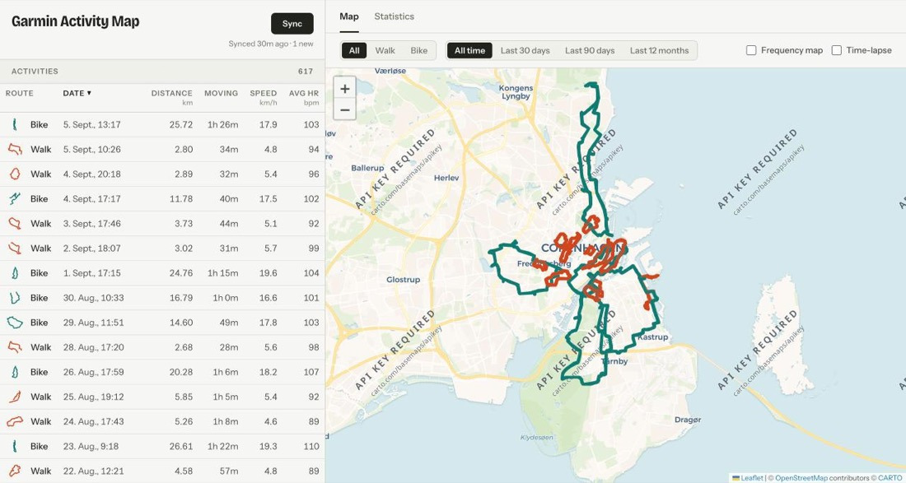
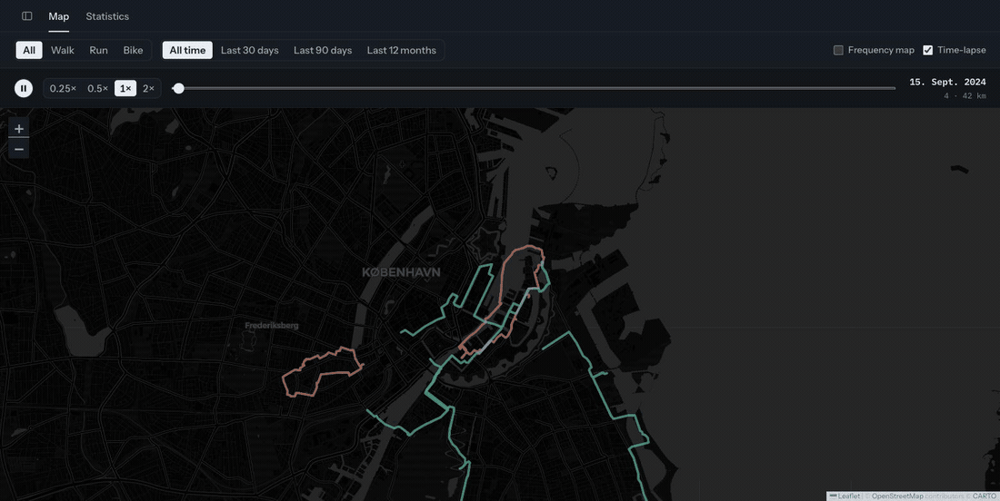
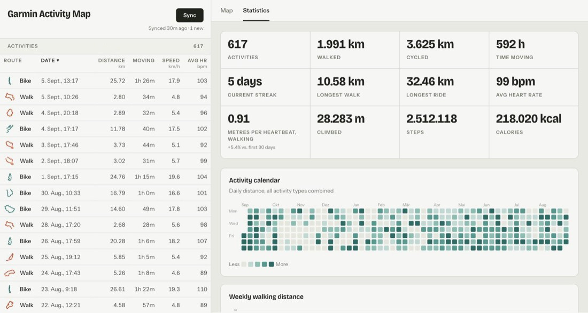

# Garmin Activity Map

**Every walk and bike ride I've logged on Garmin, drawn on one map — and the two years of sensor data behind them turned into an answer to "am I actually getting fitter?"**




|  |  |
|---|---|
| **What it is** | A personal webapp that syncs my Garmin Connect history into Postgres, maps every route, and derives fitness trends from the per-point sensor streams. |
| **Who it's for** | Me. I built it because Garmin Connect won't show me all my routes on one map, and won't tell me whether a given pace costs fewer heartbeats than it did last year. |
| **Status** | In daily use. It launches from Spotlight, I press **Update** after most walks, and the charts are the reason I keep pressing it. |
| **Stack** | React 19 · TypeScript · Vite · Leaflet · Express · Supabase (local Postgres) · zero charting libraries — every chart is hand-rolled SVG. |
| **How it was built** | Designed, specified and directed by me; implemented with **[Claude Code](https://claude.com/claude-code)**. The architecture, the data model, the algorithms below and every product decision were mine to make and defend. |

**Time-lapse mode** replaying the first sixty days at 1× — tracks are drawn as they were logged and stay on the map, and the camera follows whatever is being drawn:





> Screenshots use a synthetic demo history, not my own — I'd rather not publish my home address or my real training log. See [Demo data](#demo-data) for how it's generated, which is itself one of the more interesting parts of the project.

---

## Engineering notes

The parts that were actually hard. Each links to the code.

**Route-frequency map** — [`routeFrequency.ts`](frontend/src/lib/routeFrequency.ts)
A route walked ten times used to render as ten stacked semi-transparent lines, which reads as noise. Consecutive track points are snapped to a 30 m grid and deduplicated into segments carrying a visit count, so the same path draws once, weighted by how often I've been there. A segment's drawn position is the *average* of every real point that landed in its two cells, so the line keeps its true shape instead of going blocky. The cell size started at 15 m and was widened after real data showed a single trail still splitting into parallel lines. This replaced a `leaflet.heat` overlay that looked impressive and told me nothing.

**Hover "how often have I been here?"** — [`visitCounts.ts`](frontend/src/lib/visitCounts.ts)
Hovering any point on the map reports how many of the currently-visible activities pass within ~25 m. Naïve implementation is O(points × activities) per mouse move. Instead: a spatial grid at half the query radius, unioning the 5×5 block around the cursor — so a track 5 m away but on the far side of a cell boundary is still counted, and the fuzz stays bounded at ~40 m. The index is built lazily on first query rather than up front, so changing a filter stays instant.

**Time-lapse camera** — [`MapView.tsx`](frontend/src/components/MapView.tsx)
The naïve version — fit the camera to everything drawn so far — pulls back until a year of walking is an unreadable smudge. This one frames the current day's track together with everything already drawn within ~25 km of it: well above the span of a city's walking routes, well below the distance to the next city. So a new walk in a familiar city shows the city; a trip elsewhere flies there at the same scale. It aims wider than the cluster so the cluster must grow appreciably before the camera re-aims — a handful of moves per year, not one per day — and drawing pauses while the camera pans, so tracks are never painted across a moving map.
The scrubber cursor is a **date, not an index**, which is what makes changing a filter mid-playback hold your position instead of teleporting; a date that falls outside a narrowed range parks on the nearest end and returns when the range widens again.

**"Am I getting fitter?", done properly** — [`paceHr.ts`](frontend/src/lib/paceHr.ts)
Average speed and average heart rate both move for reasons that aren't fitness. Two derived metrics do better:
- *Metres per heartbeat* — distance ÷ beats spent moving. One number, rising means more ground for the same cardiac work.
- *Heart rate against pace* — every sensor sample binned by the pace it was recorded at, one line per quarter. A line sitting below an earlier one means that pace now costs fewer bpm. This is the like-for-like comparison. The first five minutes of each activity are dropped because heart rate lags pace at the start and would drag every band down.

The README states the confounders rather than hiding them: summer heat and hills both raise heart rate on their own, so a season-to-season difference isn't purely fitness. The card only renders once there are two quarters to compare.

**Schema split under a real payload constraint** — [`supabase/migrations/`](supabase/migrations/)
The frontend selects every column of `activities` to draw the map and the table. Inlining the per-point sensor series would have tripled the page-load payload for data only the statistics tab reads, so the streams live in their own `activity_streams` table as parallel arrays index-aligned with the track.

**Getting a macOS Spotlight launcher past TCC** — [`launcher.c`](scripts/launcher.c)
I wanted to start the whole stack (Docker, Supabase, both dev servers) from Spotlight. A script-based `.app` bundle executable is run by macOS through `/bin/bash`, so TCC attributes file access to `com.apple.bash` and a Full Disk Access grant on the app never matches — reads under `~/Documents` fail with exit 126 and no visible error. The fix is a compiled Mach-O stub that forks the helper script as a **child** rather than `exec`ing it, so the child inherits the app's code identity as its responsible process and the grant applies. Every step notifies via `osascript`, because nobody watches a log file they launched from Spotlight.

**Code comments explain *why*.** The excerpts above are lifted from the source almost verbatim — constants carry the reasoning that chose them. That's deliberate, and it's how I'd want a teammate to read this repo six months from now.

---

## Features

### Map
- Blue for walks, purple for bike rides. Hovering a line (on the map or in the table) shows Date, Distance, moving speed, and Avg. HR, and lifts it above the rest in a lighter tint so it stands out among hundreds of overlapping tracks.
- The tooltip also reports how often I've passed that exact point (see [visit index](#engineering-notes)).
- Filters: activity type (All / Walk / Bike) and date range (All time / 30 / 90 days / 12 months).
- **Frequency map** toggle collapses the individual paths into one line per route, weighted by how often I've travelled it, with a legend showing the busiest count.
- **Time-lapse mode** replays the history day by day. Playback speed 0.25×–2×, changeable mid-run; 1× puts a year of logging past in about twenty seconds. Starts at half speed, because at full speed a walk somewhere new goes by between glances. Enabling it rewinds but *doesn't* auto-play, so ticking the box never yanks the map away from what you were looking at.

### History table
Sidebar listing every activity — date, distance, moving time, speed, average HR. Sortable columns; clicking a row pans the map to that activity and highlights it, switching to the Map tab if needed.

### Statistics
- **Tiles:** total activities, distance, time moving, current streak, longest walk, longest ride, average HR, metres per heartbeat, total climb, steps, calories.
- **Calendar heatmap** of daily activity, GitHub-style.
- **Weekly distance**, walking and cycling, across the full history.
- **Speed and heart-rate progression** over time, walk vs. bike, with GPS-glitch outliers (walking "indoors") excluded from weekly averages.
- **Efficiency progression** — weekly metres per heartbeat.
- **Heart rate against pace** — the like-for-like fitness chart described above.
- **Activity patterns** by day of week and hour of day.

### Sync
An **Update** button pulls new activities from Garmin Connect, shows how long ago the last sync ran (persisted across reloads), and surfaces login/sync failures as readable messages rather than raw error strings.

---

## Architecture

```
frontend/  React 19 + TS (Vite) ──reads──> Supabase (anon, read-only)
backend/   Express + tsx        ──writes─> Supabase (service role, sole writer)
                │
                └──logs in to──> Garmin Connect (garmin-connect npm)
supabase/  Local Postgres via Docker, CLI-managed migrations
```

- **`frontend/`** — React + TypeScript, map via Leaflet / react-leaflet, charts hand-rolled as responsive SVG (no chart library). Reads activities directly from Supabase with a read-only anon key.
- **`backend/`** — a small local Express server. `POST /api/sync` logs into Garmin Connect, fetches new walk/bike activities and their GPS tracks, and writes them to Supabase with the service role key. It is the only writer; the frontend never holds write access.
- **`supabase/`** — Supabase CLI project (local Postgres in Docker). Two tables, both public-read:
  - `activities` — one row per activity: Garmin's summary figures (distance, durations, speeds, heart rate, elevation, calories, steps, cadence, HR zones, local start time and location) plus a simplified `[[lat, lng], ...]` track.
  - `activity_streams` — per-point sensor series (time, distance, speed, heart rate, elevation, cadence) as parallel arrays index-aligned with that activity's track.

**Why a backend at all?** Garmin has no official public API. Browser-side calls would expose credentials and hit CORS, so a small local server is the only thing that talks to Garmin.

Everything runs locally. Nothing is deployed — this is a tool, not a product.

---

## Setup

Prerequisites: Node.js, Docker (for local Supabase), Supabase CLI (`brew install supabase/tap/supabase`).

1. Copy `.env.example` to `.env` and fill in `GARMIN_EMAIL` / `GARMIN_PASSWORD`.
2. Start local Supabase and apply the schema:
   ```bash
   supabase start
   supabase db reset
   ```
   `supabase status` prints the local `API_URL`, `ANON_KEY` and `SERVICE_ROLE_KEY` — copy those into `.env` (see `.env.example`).
3. Install dependencies:
   ```bash
   (cd backend && npm install)
   (cd frontend && npm install)
   ```
4. Run both dev servers, in separate terminals:
   ```bash
   (cd backend && npm run dev)   # http://127.0.0.1:8787
   (cd frontend && npm run dev)  # http://localhost:5173
   ```
5. Open http://localhost:5173 and press **Update**. The first sync backfills the full history and takes a while — Garmin is called once per activity, with a delay between calls to stay under rate limits. Later syncs only fetch what's missing, so they're fast.

`supabase stop` shuts the local stack down.

---

## Scripts

| Command | Directory | What it does |
|---|---|---|
| `npm run dev` | `backend/`, `frontend/` | Dev servers |
| `npm run backfill` | `backend/` | Re-fetch sensor streams for activities synced before those columns existed |
| `npm run seed:demo` | `backend/` | Replace the DB with the synthetic demo history |
| `npm run seed:restore` | `backend/` | Restore the real history from the local backup |
| `npm run snap-routes` | `backend/` | Resolve hand-placed demo route corners into real street geometry |
| `npm run typecheck` | `backend/` | `tsc --noEmit` |
| `npm run lint` | `frontend/` | oxlint |

### Backfilling sensor data

`npm run backfill` re-fetches every activity already in the database that has no sensor streams, filling in the per-point series and the extra summary fields.

It's deliberately separate from **Update**: a routine sync stops as soon as it hits a page of activities it already knows about — right for an incremental update, exactly wrong for a backfill, where every activity already exists and the whole history must be walked. Safe to re-run; it skips whatever already has streams, so an interrupted or rate-limited run picks up where it stopped.

---

## Demo data

`npm run seed:demo` replaces the database with a synthetic history so the app can be screenshotted and recorded without publishing a real home address or training log. `npm run seed:restore` puts the real data back.

The seed backs up the real rows to `backend/.demo-backup.json` (gitignored) before wiping, which is what makes it safe to run against a working database — restoring is a local file copy, not a fresh Garmin sync and backfill. Running the seed twice keeps the existing backup rather than overwriting it with the synthetic rows it would then be reading.

**The generated history is built to exercise the app, not to fill tables.** Two years of walking and cycling around Copenhagen, plus two trips away so the time-lapse camera has somewhere to fly to:
- Routes follow real streets and are repeated with realistic GPS scatter, so the frequency layer has something to merge.
- Heart rate follows pace with a lag and a slow downward drift, so the efficiency and HR-against-pace charts show a real trend.
- Activity days cluster into streaks and thin out over winter, so the calendar heatmap looks like a habit rather than a coin flip.
- Every summary figure is derived from the generated sensor streams, so tiles, charts and tracks all agree.

Deterministic apart from its end date, which follows today so the streak tile and calendar stay current.

**Route geometry** is hand-placed corners in `demoRoutes.ts`, resolved into the actual streets and footpaths between them by `npm run snap-routes` and committed as `demoRouteGeometry.json`. Seeding therefore stays offline and deterministic — a routing service in the seed path would make every run depend on someone else's uptime — and only that script needs re-running when a route changes. It uses the OpenStreetMap community's public Valhalla instance (no API key, with pedestrian and bicycle costings), so a walking loop follows the paths through a park rather than the ring road around it. A repair pass pulls corners that sit off the walkable network — in the middle of a harbour, usually — onto the nearest spot reachable from both neighbours, which is what stops a 4 km loop from routing 60 km round the long way to a bridge.

> ⚠️ Don't press **Update** while the demo data is loaded — it would sync real Garmin activities into the middle of it.
